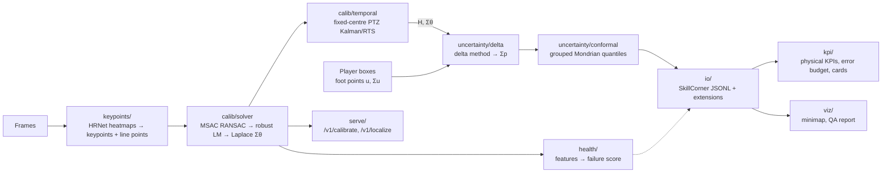

# Architecture

## Pipeline

The keypoint networks run **once per frame**: their decoded detections are cached per clip
(`PREDFOOT_DATA_DIR/cache/`, `.npz`, keyed by the model family and the number of frames on disk). Every later
stage reads the cache, so experiments run in minutes: the PTZ dev evaluation of 115 clips took 404 s from
saved calibrations (`reports/m2_temporal_dev.md`).

What runs where today:

| Stage | `predfoot run` (`pipeline/real.py`) | Dev evaluation (`scripts/`) |
|---|---|---|
| Robust calibration, Laplace Σθ | yes | `eval_dev.py` |
| PTZ smoothing | accepted by `real_stages(temporal=...)`, not exposed by the command line | `eval_dev.py --smooth ptz` (and `proj`, the projection ablation) |
| Delta method, Mondrian conformal regions | yes (`--conformal`, a model from `scripts/fit_conformal.py`) | `eval_dev.py`, leave one game out |
| Health score and abstention | stub: `calib_health` null, abstain when the calibration fails | `eval_health.py`, out-of-game classifiers |
| KPI budget and cards | no | `error_process.py`, `kpi_spectral.py`, `kpi_card.py` |

## Modules

| Module | Input → output |
|---|---|
| `geometry` | Pitch template (FIFA dimensions), homography helpers, projections, Jacobians; pinhole and fixed-centre PTZ camera models |
| `keypoints` | Frame → `KeypointObs`, `LinePointObs` (pixels): PnLCalib networks, heatmap decoding, the per-clip detection cache, ONNX export and ONNX Runtime inference |
| `calib` | Observations → `CalibResult` (H, Σθ, residuals, status) (`solver`); line fits, the line oracle and line reprojection (`lines`); the PTZ Kalman/RTS smoother, its label-free noise fit and its frame flags (`temporal`) |
| `uncertainty` | `CalibResult` + foot points → position and Σp (`delta`); grouped split conformal with Mondrian bins (`conformal`) |
| `health` | Calibration features (no labels) for the failure detector |
| `eval` | Selective prediction: error removed by abstaining on the riskiest frames |
| `io` | Dataset loaders (SN-GSR, SoccerTrack v2, IDSSE), coordinate conventions, SkillCorner JSONL writer and reader, export time base, JSON Schema and validator, downloads and manifest |
| `kpi` | Speeds and physical KPIs at 10 fps; error models (AR(1), spectral `noise`); simulation on clean tracking; the model-free 5 fps proxy; KPI uncertainty cards; budget reports |
| `viz` | Minimaps, the self-contained QA report |
| `pipeline` | Clip input, stub and real stages, orchestration per frame, export blocks with resume |
| `serve` | HTTP API (FastAPI): `/v1/calibrate`, `/v1/localize`, `/healthz`, `/metrics` |
| `demo` | Virtual broadcast cameras inside SoccerTrack v2 panoramas, and the dev calibration the demo borrows |
| `detect` | Placeholder: foot points come from labelled boxes for now |

Shared contracts live in `predfoot/contracts.py`; conventions in [ADR-0001](docs/adr/0001-conventions.md).

## Evaluation

Experiments read the cache and the label index (`PREDFOOT_DATA_DIR/index/`, dev clips only; the locked test
split's tables live apart) and write a run folder `runs/<date>_<sha>_<variant>/` that stays local:
`players.parquet` (one row per player-frame: errors against each reference, Σp, conformal features, frame
flags), `frames.parquet` (health features, line reprojection, smoother diagnostics) and `calib.npz` (every
calibration, reusable with `--calib-from`). Reports with aggregate numbers go to `reports/`, each naming its
command, commit and run folder.

| Script | What it measures | Report |
|---|---|---|
| `eval_dev.py` | Position errors and leave-one-game-out coverage of the 90 % regions against the labels and the line oracle; `--smooth none, proj, ptz` | `m2_logo_dev.md`, `m2_temporal_dev.md` |
| `eval_health.py` | Out-of-game failure detection from the health features | `m3_health_dev.md` |
| `error_process.py` | Common and individual error processes, model-free KPI proxy | `error_process_temporal_dev.md` |
| `kpi_spectral.py`, `kpi_card.py` | KPI budget and cards on IDSSE with simulated errors | `kpi_budget_spectral.md`, `kpi_card.md` |
| `make_figures.py` | Coverage at four levels, pooled and with every clip weighted equally; region size, coverage by distance and by clip size, KPI proxy | `dev_figures.md` |
| `render_minimap_demo.py` | The README animation (minimaps only) | `minimap_demo.md` |

## Outputs of a run

`tracking.jsonl` (one SkillCorner-style record per frame at 10 fps, plus `p90_radius_m`, `pos_cov_m2`,
`calib_health`, `abstain`; schema `src/predfoot/io/schema/frame-1.0.json`), `match.json`, `meta.json`
(versions, hashes, the stages that ran, the conformal model and its quantiles), `metrics.json`, `minimap.png`
and `qa_report.html` (`predfoot.viz.qa_report`: a self-contained HTML page, rebuilt by `predfoot qa`).

The calibrated covariance of a player is (q̂ / χ²₂(0.90)) · Σp, so its 90 % ellipse is exactly the conformal
region {e : eᵀ Σp⁻¹ e ≤ q̂}, and `p90_radius_m` = √(q̂ · λmax(Σp)) is the circle that contains it.

Runs are processed in blocks of export frames written atomically to `OUT/.parts/`. A re-run with the same
input, configuration and stages reuses the finished blocks, so a killed run resumes to byte-identical files
(only `metrics.json`, which holds timings, differs).

Detections reach the real stages keyed by the 0-based index of the clip's frames; the detection cache keys
them by image number, and `predfoot.keypoints.cache.by_clip_index` converts. `Stages.check_clip` lets stages
refuse a clip they were not built for before anything is computed (the real stages refuse detections beyond
the clip's last frame).

The real stages are pinned by a golden test: synthetic detections of a known camera
(`tests/fixtures/golden/`) through calibration, conformal regions, localization and export, compared with
committed outputs.
