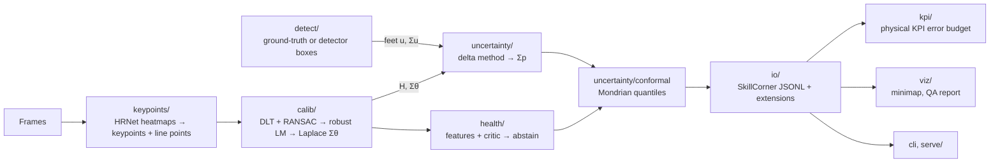

# Architecture

## Pipeline

The keypoint network runs **once per frame**; its outputs are cached as Parquet, keyed by the hash of the
weights and of the decoding config. Every later stage reads the cache, so experiments run in minutes.

## Modules

| Module | Input → output |
|---|---|
| `geometry` | Pitch template (FIFA dimensions), homography helpers, projections, Jacobians |
| `keypoints` | Frame → `KeypointObs`, `LinePointObs` (pixels); ONNX export and ONNX Runtime inference |
| `calib` | Observations → `CalibResult` (H, Σθ, residuals, status) |
| `uncertainty` | `CalibResult` + `FootObs` → `Localization` (position, Σp); conformal calibration |
| `health` | Calibration features (+ frame) → failure probability, abstention |
| `detect` | Frame → `FootObs` (ground-truth boxes for evaluation, a detector for demos) |
| `io` | Dataset loaders, coordinate conventions, SkillCorner JSONL writer and reader, export time base, JSON Schema and validator |
| `kpi` | Tracking → physical KPIs; error injection; KPI error budget |
| `eval` | Metrics, coverage, risk–coverage, cluster bootstrap |
| `viz` | Minimaps, overlays, per-run QA report |
| `serve` | HTTP API (FastAPI): `/v1/calibrate`, `/v1/localize`, `/healthz`, `/metrics` |
| `pipeline` | Orchestration of the stages per frame, export blocks with resume; stub stages until the real modules land |

Shared contracts live in `predfoot/contracts.py`; conventions in [ADR-0001](docs/adr/0001-conventions.md).

## Outputs of a run

`tracking.jsonl` (one SkillCorner-style record per frame at 10 fps, plus `p90_radius_m`, `pos_cov_m2`,
`calib_health`, `abstain`; schema `src/predfoot/io/schema/frame-1.0.json`), `match.json`, `meta.json`
(versions, hashes, the stages that ran, the conformal model and its quantiles), `metrics.json`, `minimap.png`
and `qa_report.html` (`predfoot.viz.qa_report`: a self-contained HTML page, rebuilt by `predfoot qa`).

Runs are processed in blocks of export frames written atomically to `OUT/.parts/`. A re-run with the same
input, configuration and stages reuses the finished blocks, so a killed run resumes to byte-identical files
(only `metrics.json`, which holds timings, differs).

Detections reach the real stages keyed by the 0-based index of the clip's frames; the detection cache keys
them by image number, and `predfoot.keypoints.cache.by_clip_index` converts. `Stages.check_clip` lets stages
refuse a clip they were not built for before anything is computed (the real stages refuse detections beyond
the clip's last frame).

The real stages are pinned by a golden test: synthetic detections of a known camera
(`tests/fixtures/golden/`) through calibration, conformal regions, localization and export, compared with
committed outputs.
