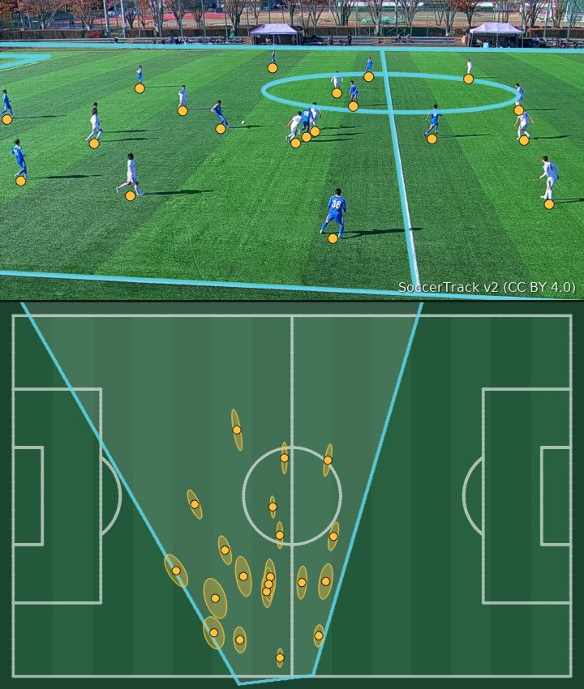
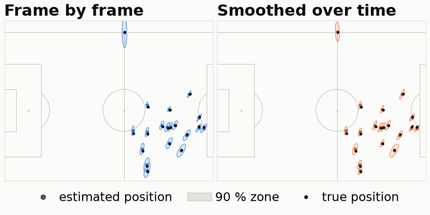

# predfoot

**Where every player stands, read from a TV picture, and how far off it could be.**

predfoot takes a frame of a football broadcast, works out from the pitch markings where the camera stands and
where it points, and places every player on the pitch in metres. Each position comes with an error zone: an
area built to hold the player's true spot 9 times out of 10. predfoot also warns when the camera estimate is
probably wrong, smooths the camera over time, and measures how camera errors distort physical stats such as
distance covered. It does not detect players: it starts from the player boxes drawn by the dataset's
annotators, so its results measure the camera and the error zones, not detection.

<a href="https://huggingface.co/spaces/Ya-SinZ/predfoot"></a>

### [Open the live page: predfoot in 30 seconds](https://huggingface.co/spaces/Ya-SinZ/predfoot)

*Public footage (SoccerTrack v2, CC BY 4.0) illustrating the output. The results below come from SoccerNet
matches, whose images cannot be shown.*

## Why it matters

Much of football's tracking data now comes from ordinary TV broadcasts. To turn a picture into positions,
software first has to work out where the camera is pointing, and when that estimate wobbles, every player on
screen moves with it. The wobble inflates stats such as distance covered and high-speed running, and the
positions rarely say how far off they might be.

## Results

predfoot was tested on three SoccerNet matches that played no part in its development, against the dataset's
annotated player positions, and compared with the camera worked out from each frame on its own.

| | On the three test matches |
|---|---|
| **Accuracy** | 9 players in 10 placed within 1.2 m of their annotated spot, against 1.8 m when the camera is worked out frame by frame |
| **Physical stats** | Total distance covered overstated by 3.4 % instead of 26.1 %; high-speed running by 5.5 % instead of 72.4 % |
| **Honest error zones** | The true position fell inside its 90 % zone 93.1 % of the time. The test asked for a result compatible with 90 %, so this is a **missed target**, on the cautious side: the zones were a bit too large. They are still 27 % smaller than a one-size-fits-all circle making the same promise |
| **Bad-camera alarm** | Setting aside the 10 % of frames it finds most suspicious removes 55 % of camera failures |

**Tested once, on matches never used during development, under a protocol frozen and published in advance**
([preregistration](docs/preregistration.md)). Every result is published, including the missed target
([test report](reports/test_run.md)).

## Smoothing the camera



*A SoccerNet development clip, drawn on a pitch diagram because SoccerNet images cannot be shown, and picked to
show the effect. Frame by frame (left), the error zones jump and swell whenever the camera estimate wobbles;
smoothed over time (right), they stay small and steady.*

## How it works

1. **Find the pitch markings.** A neural network (PnLCalib, public weights, not retrained) spots the lines of
   the pitch, and the points where they cross, in each frame.
2. **Recover the camera.** The pitch is a known 105 × 68 m shape, so those markings reveal where the camera is
   and where it points. This is called calibration; predfoot also measures how sure it can be of it.
3. **Smooth over time.** A TV camera pans, tilts and zooms around an almost fixed point. predfoot uses this to
   smooth the camera across the clip and to catch frames that do not fit.
4. **Place each player, with an error zone.** Each player's feet are projected onto the pitch with a zone built
   to hold the true spot 9 times in 10, tuned on past matches so it keeps that promise. A health score flags
   frames whose camera looks wrong.

## Limits

- Tested on three matches from one league and one broadcast style.
- Players come from the dataset's annotated boxes: detecting and tracking them is not part of the project.
- The error zones were slightly cautious on the test matches.
- The bad-camera alarm and the physical-stat measurements run in the evaluation scripts, not yet in the
  command-line tool.

## For engineers

The method, every number and how to reproduce it are in the [technical overview](docs/technical.md). Outputs
follow the SkillCorner open-data format at 10 fps (kloppy loads them), with the error zones as extra fields.
A quick start that needs no dataset, on synthetic detections of a known camera:

```bash
uv sync
uv run predfoot run tests/fixtures/golden/clip.json --out out-golden/ \
    --detections tests/fixtures/golden/detections.json --conformal tests/fixtures/golden/conformal.json
uv run predfoot qa out-golden/    # rebuilds the run's one-page HTML report
```

- [Technical overview](docs/technical.md): how it works in detail, all results, reproduction, layout
- [Reports](reports/README.md): every generated report, with the command and commit behind it
- [Preregistration](docs/preregistration.md) and [test report](reports/test_run.md)
- [HTTP API and latency](docs/serving.md), [Docker images](docs/docker.md)
- [Showcase page](site/page.html), built for the live page by `scripts/build_site.py`

> Preregistration v1 frozen on 2026-11-01 at commit `a46c15aaaea4`: `docs/preregistration.md` SHA-256
> `25bf24bf31da3027…`, artifacts digest `20f06142cba1522c…`, `docs/preregistration.lock.json` SHA-256
> `191bb06dbb75aba8…`; hashes in [`docs/preregistration.lock.json`](docs/preregistration.lock.json).

## Licence and credits

Apache-2.0. Footage: SoccerTrack v2, Scott et al., CC BY 4.0. Test data: SoccerNet SN-GSR, shown only as
numbers, plots and pitch diagrams. Pitch-marking network: PnLCalib weights by Gutiérrez-Pérez and Agudo,
CC BY 4.0. Every third-party resource is credited in [ATTRIBUTION.md](ATTRIBUTION.md). predfoot is an
independent project, not affiliated with SkillCorner.
