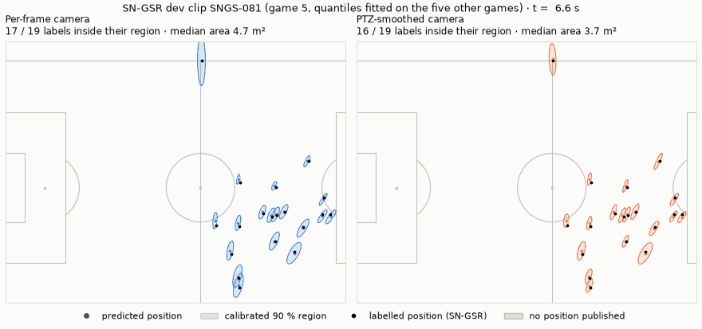
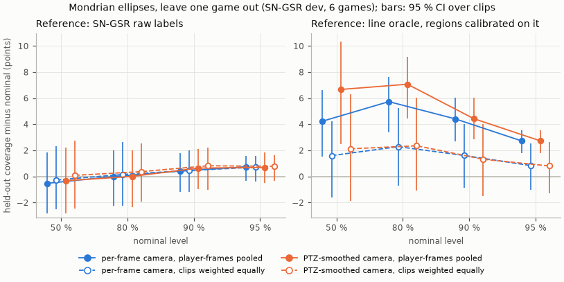
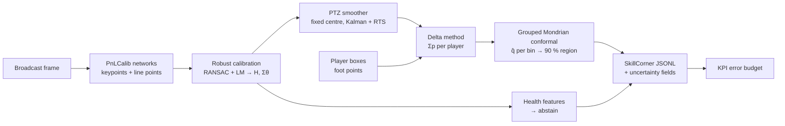
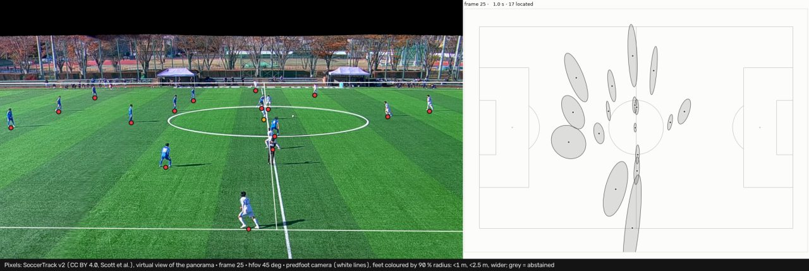

# predfoot: technical overview

The engineering side of predfoot: what it computes, the preregistered test and the development results with
all their numbers, what the evidence shows and what it does not, and how to run and reproduce everything. The
[README](../README.md) is the short version in plain words, and the
[showcase page](https://huggingface.co/spaces/Ya-SinZ/predfoot) the visual one.

**Calibrated position uncertainty for broadcast football tracking.**

Broadcast tracking gives every player a pitch position, but no error bar. predfoot calibrates the camera of
each broadcast frame from the pitch markings and adds three things to the positions it produces:

- a **90 % region per player and frame**, an ellipse calibrated by conformal prediction on games held out
  from every fitting step;
- a **calibration health score** that flags frames whose camera is probably wrong, so they can abstain
  (evaluated on the development games, not yet wired into `predfoot run`);
- an **error budget for physical KPIs** (distance, high-speed running, sprints, PSV-99), measured on the
  development games with a model-free 5 fps proxy and simulated on IDSSE tracking, by scripts (`predfoot run`
  computes no KPI yet).

Outputs follow the SkillCorner open-data JSONL schema at 10 fps, with the uncertainty as extra fields
(`p90_radius_m`, `pos_cov_m2`, `calib_health`, `abstain`).

> **Test and development results.** The SN-GSR test games (7, 8 and 11) were evaluated once, as preregistered
> ([`docs/preregistration.md`](preregistration.md)); [the results](#preregistered-test-results) are all
> published, the failed criterion included. Everything else comes from the six development games.
>
> Preregistration v1, frozen on 2026-11-01 by commit `8640b9a` at 11:56 UTC, about an hour before the test run
> started (12:58 UTC), on code commit `a46c15aaaea4`: `docs/preregistration.md` SHA-256 `25bf24bf31da3027…`,
> artifacts digest `20f06142cba1522c…`, `docs/preregistration.lock.json` SHA-256 `191bb06dbb75aba8…`; hashes in
> [`docs/preregistration.lock.json`](preregistration.lock.json). The repository was private when the protocol
> was frozen: the timing can be checked in its git history.



One SN-GSR dev clip (SNGS-081, game 5), 15 s at 5 fps, with the labelled player boxes as input. Left: the
camera calibrated frame by frame; right: the same calibrations smoothed over time. Each shaded ellipse is a
player's calibrated 90 % region, with quantiles fitted on the five other dev games; black dots are the labelled
positions. A grey panel publishes no position. A hatched panel did publish positions, but SN-GSR has no
position labels on that frame, so nothing checks them: on one of the two such frames, both cameras miss the
annotated lines by 534.9 px. The clip and the window were picked on the labels, by a stated rule, to show the
smoothing, and are not typical: over the clip the frame-to-frame jitter of the common-mode error falls from
0.52 m to 0.11 m (ratio 0.21, median over the dev clips 0.35), and the window is the clip's most jittery 15 s
for the per-frame camera (0.73 m against 0.12 m; [`reports/minimap_demo.md`](../reports/minimap_demo.md)).
SoccerNet frames cannot be redistributed, so SoccerNet results appear only as metrics, plots and minimaps.

## Preregistered test results

The 49 clips of the locked test games, run once on 2026-11-01 with the models frozen on the dev games
(freeze commit `8640b9a`). Every number is in [`reports/test_run.md`](../reports/test_run.md).

| | Success criterion (preregistered) | Result | Verdict |
|---|---|---|---|
| P1 | Coverage of the 90 % regions, PTZ-smoothed camera, raw labels: the 95 % interval contains 90 % | 93.1 % [91.7, 94.5] | **not met** (over-coverage) |
| P2 | Median region area / constant circle at the same level | 0.73 [0.70, 0.77] | **met** |
| P3 | Failure-detection AUROC on the per-frame calibrations, gradient boosting − best dev single feature (`log_sigma_centre`) | 0.911 − 0.797 = +0.114 [+0.084, +0.150] | **met** |

| Test games, raw labels as reference | Per-frame camera | PTZ-smoothed camera |
|---|---|---|
| Coverage of the 90 % regions [95 % CI] | 90.7 % [88.8, 92.6] | 93.1 % [91.7, 94.5] |
| ... per test game (7, 8, 11) | 89.8, 89.3, 92.9 % | 89.8, 93.2, 96.0 % |
| Median region area; constant circle | 4.69 m²; 13.98 m² | 5.17 m²; 7.03 m² |
| Position error p50 / p90 / p99 (same player-frames) | 0.51 / 1.82 / 6.87 m | 0.40 / 1.16 / 4.00 m |
| Frames more than 10 px from the annotated lines | 9.7 % | 2.4 % |
| KPI proxy, distance / high-speed-running distance bias | +26.1 % / +72.4 % | +3.4 % / +5.5 % |

The KPI proxy compares 5 fps tracks with the dataset's smoothed labels, not with the raw labels, which differ
from them by +17.0 % / +40.3 % on the smoothed camera's runs; each camera's runs break wherever its error
against the labels reaches 10 m, which leaves gross failures to abstention, something `predfoot run` cannot do
yet. As the preregistration states (section 8), it measures the cost of jitter, not absolute KPI accuracy.
The failure detector was scored on the per-frame calibrations (3839 frames, 10.2 % failures), not on the
smoothed camera, which fails on 2.4 % of the frames.

Reading, after the fact (not preregistered): the smoothed camera's regions are conservative on these three
games. The constant circle calibrated on the same dev errors over-covers as much (94.1 %), so the miss comes
from the test games' errors being smaller than the dev games' (p90 1.16 m against 1.46 m on dev), not from the
Mondrian bins; game 11 alone covers 96.0 %. The preregistration had stated this risk: on dev, the smoothed
camera's coverage per held-out game ranged from 84.0 to 95.6 %, and a bootstrap over the clips of three games
cannot capture the variability between games. The per-frame camera, the comparison arm, lands at 90.7 %.
Smoothing keeps its other gains on the test games: smaller errors, a quarter of the line failures, and KPI
biases below the reference's own noise floor (+17.0 % / +40.3 % on the smoothed camera's runs).

## Development results

SN-GSR dev: 115 clips from games 2, 3, 4, 5, 6 and 9, frames one in five, labelled boxes as foot points.
Leave one game out: each game's conformal quantiles are fitted on the five other games. Intervals resample
clips, since frames within a clip are correlated.

| | Per-frame camera | PTZ-smoothed camera |
|---|---|---|
| Coverage of the 90 % regions, raw labels as reference [95 % CI] | 90.4 % [88.8, 91.8] | 90.6 % [89.0, 92.1] |
| ... each clip weighted equally | 90.5 % [88.8, 92.0] | 90.8 % [89.0, 92.2] |
| ... per held-out game | 85.6 to 93.3 % | 84.0 to 95.6 % |
| Coverage of 90 % regions calibrated on the trusted line oracle, against it [95 % CI] | 94.4 % [92.7, 96.0] | 94.4 % [92.9, 96.0] |
| ... each clip weighted equally | 91.6 % [89.1, 94.0] | 91.3 % [88.5, 94.0] |
| Median region area; constant circle at the same nominal level | 6.21 m²; 14.56 m² | 5.37 m²; 7.44 m² |
| Position error against the raw labels, p50 / p90 / p99 | 0.59 / 2.02 / 5.64 m | 0.46 / 1.46 / 3.99 m |
| Line reprojection p90; frames above 10 px (9950 frames with self-consistent line annotations) | 10.4 px; 10.7 % | 4.9 px; 1.0 % |
| KPI proxy, distance / high-speed-running distance bias | +27.0 % / +67.2 % | +2.7 % / +6.2 % |
| Frames with published positions | 95.5 % | 95.1 % |

Sources: [`m2_logo_dev.md`](../reports/m2_logo_dev.md), [`m2_temporal_dev.md`](../reports/m2_temporal_dev.md),
[`error_process_temporal_dev.md`](../reports/error_process_temporal_dev.md), and
[`dev_figures.md`](../reports/dev_figures.md) for the rows with each clip weighted equally (for the smoothed
camera, an approximation of the fold-wise fit explained there). Coverage pools the held-out player-frames
unless a row says otherwise. The constant circle covers 90.9 % and 90.5 %. Before the conformal step, the
Laplace ellipses cover only 17.9 % (per-frame) and 7.2 % (smoothed) at the same level. The KPI proxy compares
5 fps tracks with the smoothed labels, whose raw counterparts have their own bias of +17.9 % / +43.1 % against
them. It leaves out player-frames 10 m or more from the labels, as calibration failures for abstention to
catch, which `predfoot run` cannot do yet.

Failure detection, per-frame camera ([`m3_health_dev.md`](../reports/m3_health_dev.md)): a frame fails when the
annotated lines sit more than 10 px from the projected pitch (11.0 % of 10024 frames). Scored out-of-game, the
AUROC is 0.89 for gradient boosting, 0.79 for logistic regression and 0.73 for the best single feature;
abstaining on the riskiest 10 % of frames removes 50 %, 32 % and 29 % of the failures.



At the 50, 80, 90 and 95 % levels the regions cover 49.5, 80.0, 90.4 and 95.7 % of the labelled positions
(per-frame camera; smoothed: 49.7, 80.0, 90.6 and 95.7 %); weighting each clip equally moves these by at most
0.4 points. Regions calibrated on the line oracle instead cover more than nominal at every level when
player-frames are pooled, but only 0.8 to 2.4 points more, every interval containing nominal, when each clip
weighs the same, as the conformal quantile weighs its calibration clips (see the evidence below). Region size
against the constant circle, coverage by distance and by clip size, and the KPI proxy:
[`reports/dev_figures.md`](../reports/dev_figures.md).

## How it works



1. **Calibration.** PnLCalib's keypoint and line networks (published CC BY 4.0 weights, not fine-tuned) find
   pitch keypoints and points on the lines. MSAC RANSAC and a robust Levenberg-Marquardt fit give the
   homography H; a Laplace approximation gives the 8 × 8 covariance Σθ of its parameters.
2. **Fixed-centre PTZ smoothing.** A broadcast camera pans, tilts and zooms around an almost fixed point. Per
   clip, predfoot estimates that projection centre without labels and projects each frame's homography onto
   pan, tilt, roll and log focal length (4 degrees of freedom instead of 8). A constant-velocity Kalman
   filter and RTS smoother run on them within shot segments, with noise parameters fitted on the innovations
   of other games. A brief run of frames the PTZ model cannot explain (at most 0.5 s) gets the smoothed
   camera, a longer one keeps its own; frames of a segment whose calibration failed are filled from the
   smoother.
3. **Delta method, then grouped Mondrian conformal.** Σθ is propagated to each foot point:
   Σp = J Σθ Jᵀ. The score of a position error e is d² = eᵀ Σp⁻¹ e, and the region is
   {e : eᵀ Σp⁻¹ e ≤ q̂}. q̂ is a split-conformal quantile grouped by clip (every clip weighs the same, and the
   finite-sample correction counts clips), per Mondrian bin of metres per pixel at the feet × RANSAC inliers,
   within each covariance source (smoothed, bridged or filled, single frame).
4. **Health and abstention.** Features of each calibration (spread of a predicted position at the image
   centre, jump from the previous frame, residuals, inlier geometry) feed a failure classifier.
5. **Export and KPIs.** Records follow the SkillCorner open-data schema at 10 fps (kloppy loads them); the KPI
   modules compute distance, high-speed running, sprints and PSV-99 at 10 fps and how position errors bias
   them.

**What `predfoot run` does today:** steps 1 and 3 and the export of step 5, from cached network detections.
The PTZ smoother is implemented and used by the dev evaluation, and the real pipeline stages accept it, but the
command line does not expose it yet. The health classifier is evaluated on dev only
(`scripts/eval_health.py`): in `predfoot run`, `calib_health` is null and a frame abstains when its
calibration fails. The KPI modules run only in the evaluation scripts; a run's outputs hold no KPI. Details:
[ARCHITECTURE.md](../ARCHITECTURE.md), conventions in [ADR-0001](adr/0001-conventions.md).

## What the evidence shows, and what it does not

- **Coverage holds on held-out games, on average.** Against the raw labels the regions cover the nominal
  level at 50 to 95 % and in each distance tercile (89.6 to 91.1 % at 90 %), but per held-out game coverage
  ranges from 84.0 % (game 6) to 95.6 % (game 3) for the smoothed camera. On the three test games the
  smoothed camera's regions over-cover (93.1 % [91.7, 94.5]), which fails the preregistered criterion, while
  the per-frame camera's cover 90.7 %: the conformal guarantee is an average over games, and three games can
  sit away from it.
- **Neither reference is the truth.** The SN-GSR labels are the annotators' camera applied to the boxes; that
  camera sits 3.9 px (median) from the annotated lines ([`spike_s0.md`](../reports/spike_s0.md)). The trusted line
  oracle is a homography fitted to the annotated lines of each frame, kept where it fits them within 3 px.
  Since it is fitted frame by frame, it penalises a smooth camera: regions calibrated on its errors double in
  median area with smoothing (12.58 to 26.16 m²).
- **Against the line oracle, the weighting of coverage matters.** Regions calibrated on oracle errors cover
  94.4 % of the held-out player-frames at 90 %, for both cameras. The conformal quantile weighs every
  calibration clip equally, while that coverage weighs player-frames, and against the oracle a clip's coverage
  rises with its number of trusted player-frames: 84.6 % in the smallest third of the clips, 96.6 % in the
  largest (per-frame camera). Weighting each clip equally gives 91.6 % [89.1, 94.0] for the per-frame camera
  and 91.3 % [88.5, 94.0] for the smoothed one; against the labels the two weightings agree (90.4 and 90.5 %,
  per-frame camera). The preregistration takes the raw labels as its primary reference (the oracle penalises a
  smooth camera and fails grossly on about 1.5 % of its own player-frames), decides its coverage criterion on
  pooled player-frames, and reports the coverage with clips weighted equally next to it.
- **Inputs are labelled boxes.** Detection and tracking errors are not part of these numbers.
- **SoccerTrack v2 supplies demo pixels only.** Its released calibration misses its own annotated keypoints by
  8 to 23 px (median), metres on the far half of the pitch, so it cannot referee predfoot. On its virtual
  broadcast views, the dev quantiles cover 52.0 % of positions (92.7 % on the near half, 33.1 % on the far
  half; [`soccertrack_v2.md`](../reports/soccertrack_v2.md)).
- **The KPI simulation overstates the cost.** The measured evidence is the model-free proxy above (5 fps
  against the smoothed labels), where the smoothed camera's bias is below the reference's own noise floor. A
  spectral error model fitted to the same errors and injected into clean IDSSE tracking gives 1.6 to 5.1 times
  the measured proxy biases and fails its 5 fps check for the smoothed camera, so its budget is an upper bound,
  not predfoot's KPI error ([`kpi_budget_spectral.md`](../reports/kpi_budget_spectral.md)). The per-player KPI
  cards are checked only on simulated errors ([`kpi_card.md`](../reports/kpi_card.md)).
- **Scope.** Six development games and three test games from one league and broadcast style; no claim
  beyond that.

## Quick start

No dataset needed: the golden fixture holds synthetic network detections of a known camera. Commands run
from the repository root.

```bash
uv sync                                             # Python 3.12 and the dev tools; no torch
uv run predfoot run tests/fixtures/golden/clip.json --out out-golden/ \
    --detections tests/fixtures/golden/detections.json --conformal tests/fixtures/golden/conformal.json
uv run python -m predfoot.io.compare out-golden/ tests/fixtures/golden/expected/
uv run predfoot validate out-golden/tracking.jsonl --match out-golden/match.json
uv run predfoot qa out-golden/                      # rebuilds out-golden/qa_report.html
uv run pytest -m "not slow and not data and not network and not vision"   # what CI runs
```

`predfoot run` calibrates each frame, places the feet with their covariances, scales the regions with the
conformal model and writes `tracking.jsonl`, `match.json` (loadable with kloppy), `meta.json` (versions,
hashes, stages, conformal model), `metrics.json`, `minimap.png` and `qa_report.html` (one self-contained
page). Without `--detections` it runs stub stages from a clip JSON (`tests/fixtures/synthetic_clip.json`).

## Reproducing the development results

These steps need the SN-GSR data from Hugging Face (`SoccerNet/SN-GSR-2025`, a token read by
`huggingface_hub`), the PnLCalib weights and the `vision` extra. Downloads go to `PREDFOOT_DATA_DIR`; frame
downloads and keypoint caching refuse the locked test split.

```bash
export PREDFOOT_DATA_DIR=/path/to/data
uv sync --extra vision
uv run python scripts/download_data.py sn-gsr-labels --splits train valid
uv run python scripts/build_index.py
uv run python scripts/download_data.py sn-gsr-frames --all-dev --every 5
uv run python scripts/download_data.py pnlcalib-weights
uv run python scripts/cache_keypoints.py           # network inference on every dev frame, once
uv run python scripts/eval_dev.py                  # per-frame camera → reports/m2_logo_dev.md, runs/<none>/
uv run python scripts/eval_dev.py --smooth ptz --calib-from runs/<none>/calib.npz   # → runs/<ptz>/report.md
uv run python scripts/eval_health.py runs/<none>/frames.parquet
uv run python scripts/error_process.py runs/<ptz>/players.parquet --compare runs/<none>/players.parquet \
    --name ptz --compare-name none --out reports/error_process_temporal_dev.md \
    --json reports/error_process_temporal_dev.json
uv run python scripts/make_figures.py --none-run runs/<none> --ptz-run runs/<ptz>
uv run python scripts/render_minimap_demo.py --none-run runs/<none> --ptz-run runs/<ptz>
```

`scripts/modal_cache_keypoints.py` runs the network inference on Modal instead of locally. Every report
names the command, commit and run folder it came from; the run folders (`runs/`) stay local.

## Demo on SoccerTrack v2 pixels



Public pixels come from SoccerTrack v2 (CC BY 4.0): a virtual broadcast camera turns inside the fixed panorama
of match 117093. predfoot calibrates each view from the pitch lines (magenta), with SoccerTrack's released
calibration in cyan, and draws the 90 % regions of the ground-truth boxes' foot points on the minimap. The
regions borrow the SN-GSR dev quantiles (`src/predfoot/demo/dev_calibration.json`, aggregate numbers only), so
the demo needs no SoccerNet data. The still comes from a 10-frame smoke run with 7 to 11 inliers per view; on
the night match 117092 every frame abstains. Pixels: SoccerTrack v2 (Scott et al.), cropped and reprojected.

```bash
uv sync --extra vision
uv run python scripts/download_data.py soccertrack-v2 --match 117093 --parts raw mot clip
uv run python scripts/download_data.py pnlcalib-weights
uv run python scripts/render_demo.py --match 117093 --start 0 --frames 10 --step 5 --fps 5   # runs/<run>/demo.mp4
```

## Serving and Docker

- `predfoot serve` exposes `/v1/calibrate` (image → camera and Σθ), `/v1/localize` (camera and foot points →
  positions with calibrated regions), `/healthz` and `/metrics`: [`docs/serving.md`](serving.md), with
  ONNX export and latency (0.46 s per frame for both networks with ONNX Runtime CoreML on an M4 Pro,
  [`reports/latency_m4.md`](../reports/latency_m4.md)).
- `docker/Dockerfile.cpu` builds a CLI image and a serving image without torch, smoke-tested in CI and
  released to the GitHub Container Registry on version tags: [`docs/docker.md`](docker.md).

## Showcase page

`site/page.html` is the visual summary for visitors, published as a static Hugging Face Space
(<https://huggingface.co/spaces/Ya-SinZ/predfoot>). It shows the four headline results of the test run; its only
footage comes from SoccerTrack v2, and SoccerNet appears as numbers and a pitch-diagram clip only.
`scripts/build_site.py` wraps it into `site/dist/index.html`, copies the media it references from
`assets/showcase/` and writes the Space's `README.md`; it fails when a referenced file is missing, when the page
loads anything but Google Fonts from outside, when a link to another site does not open a new tab (the Space
shows the page in a frame that GitHub refuses to load), or when the page and its media exceed 4 MB.
`scripts/deploy_space.py` refuses a stale build and any link to another site that does not answer 200 to an
anonymous request, so the Space cannot go public before the repository and its evidence do
(`--skip-link-check` for a private preview); it then creates the Space if needed and uploads `site/dist/` as
one commit (it needs a Hugging Face token with write access).

The media come from `scripts/render_hero.py` (the hero loop: predfoot on SoccerTrack v2 match 117093, an
illustration with no reference to score against) and `scripts/render_minimap_demo.py --style page` (the smoothing
clip, side by side and stacked for phones: an SN-GSR dev clip drawn on pitch diagrams; `--style plain` makes the
README's GIF). [`reports/showcase_visuals.md`](../reports/showcase_visuals.md)
gives each file's command, commit and size, and what it does not show.

```bash
uv run python scripts/build_site.py      # → site/dist/ (git-ignored)
uv run python scripts/deploy_space.py    # → huggingface.co/spaces/Ya-SinZ/predfoot
```

## Layout

| Path | Contents |
|---|---|
| `src/predfoot/` | The package: `geometry`, `keypoints`, `calib`, `uncertainty`, `health`, `io`, `kpi`, `eval`, `viz`, `pipeline`, `serve`, `demo` |
| `scripts/` | Data download, experiments and evaluations, figures, checks |
| `tests/` | `unit`, `property` (hypothesis), `integration`; synthetic fixtures and a three-record SkillCorner excerpt |
| `reports/` | Generated reports with aggregate numbers, and their figures ([index](../reports/README.md)) |
| `docs/` | This overview, architecture decision records, preregistration, serving and Docker |
| `configs/` | YAML configs, validated with pydantic |
| `docker/` | CPU images and their smoke tests |
| `assets/` | Images for the README and this overview; `showcase/` holds the media of the showcase page |
| `site/` | The showcase page (`page.html`); `scripts/build_site.py` builds it into `site/dist/` |

## Development

```bash
uv sync --extra serve        # core, dev tools and the API extra, as in CI; add --extra vision for torch
uv run pre-commit install
uv run ruff check . && uv run ruff format --check . && uv run mypy
uv run pytest -m "not slow and not data and not network and not vision"
uv run python scripts/check_licenses.py
```

The golden test (`tests/integration/test_golden_real.py`) runs the real stages on the golden fixture and
compares the outputs with `tests/fixtures/golden/expected/`: exact on structure, ids and flags, within one unit
of the last written decimal on numbers. After an intended change of the outputs, regenerate it with
`uv run python scripts/make_golden.py --update` and review the diff. Working rules for contributors:
[CLAUDE.md](../CLAUDE.md).

## Licence and credits

Apache-2.0. Third-party data and weights (PnLCalib, SN-GSR, SoccerTrack v2, IDSSE, SkillCorner open data) are
credited in [ATTRIBUTION.md](../ATTRIBUTION.md); none is redistributed beyond what that file lists. predfoot is an
independent project, not affiliated with SkillCorner.
