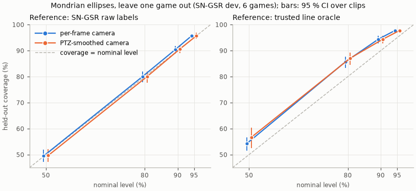
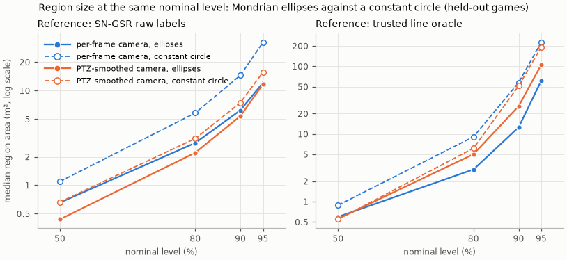
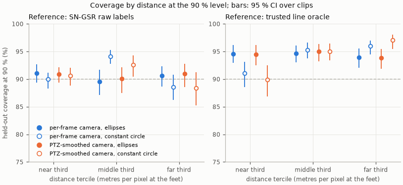
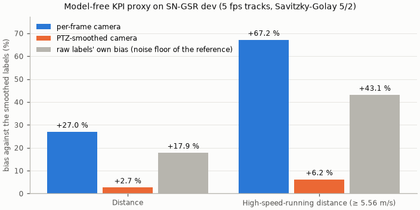

# Development figures: coverage at four levels, region size, distance terciles, KPI proxy

`uv run python scripts/make_figures.py --none-run runs/20261031-152537_c3861c7_none --ptz-run runs/20261031-163641_bf28b35_ptz` · commit `97d4689` · per-player tables `runs/20261031-152537_c3861c7_none` (per-frame camera) and `runs/20261031-163641_bf28b35_ptz` (PTZ-smoothed camera), not in git; KPI proxy from `reports/error_process_temporal_dev.json`.

Exploratory numbers on the six SN-GSR dev games (2, 3, 4, 5, 6, 9; frames one in five; ground-truth boxes), not the preregistered test (`docs/preregistration.md`). For every level, each held-out game's conformal quantiles are fitted on the five other games (`eval_dev.logo`: Mondrian bins over metres per pixel at the feet × RANSAC inliers, within each covariance source); intervals resample clips (300 draws).

## Coverage and median region area at each nominal level

| Reference | Camera | Nominal | Player-frames | Mondrian ellipses [95 % CI] | Median area (m²) | Constant circle [95 % CI] | Area (m²) |
|---|---|---|---|---|---|---|---|
| SN-GSR raw labels | per-frame camera | 50% | 254976 | 49.5 % [47.2, 51.8] | 0.66 | 50.4 % [48.3, 52.5] | 1.10 |
| SN-GSR raw labels | per-frame camera | 80% | 254976 | 80.0 % [77.8, 82.0] | 2.80 | 80.7 % [78.5, 82.9] | 5.81 |
| SN-GSR raw labels | per-frame camera | 90% | 254976 | 90.4 % [88.8, 91.8] | 6.21 | 90.9 % [89.5, 92.2] | 14.56 |
| SN-GSR raw labels | per-frame camera | 95% | 254976 | 95.7 % [94.7, 96.6] | 12.15 | 96.0 % [95.2, 96.7] | 32.39 |
| SN-GSR raw labels | PTZ-smoothed camera | 50% | 252689 | 49.7 % [47.1, 52.2] | 0.44 | 50.5 % [47.8, 52.9] | 0.66 |
| SN-GSR raw labels | PTZ-smoothed camera | 80% | 252689 | 80.0 % [77.6, 82.0] | 2.21 | 80.4 % [77.9, 82.7] | 3.12 |
| SN-GSR raw labels | PTZ-smoothed camera | 90% | 252689 | 90.6 % [89.0, 92.1] | 5.39 | 90.5 % [88.7, 92.4] | 7.47 |
| SN-GSR raw labels | PTZ-smoothed camera | 95% | 252689 | 95.7 % [94.5, 96.8] | 11.73 | 95.8 % [94.6, 96.8] | 15.73 |
| trusted line oracle | per-frame camera | 50% | 155643 | 54.2 % [51.5, 56.6] | 0.60 | 56.0 % [53.1, 58.9] | 0.89 |
| trusted line oracle | per-frame camera | 80% | 155643 | 85.7 % [83.4, 87.7] | 2.99 | 85.7 % [83.1, 87.8] | 9.09 |
| trusted line oracle | per-frame camera | 90% | 155643 | 94.4 % [92.8, 95.8] | 12.58 | 94.1 % [92.5, 95.3] | 57.72 |
| trusted line oracle | per-frame camera | 95% | 155643 | 97.7 % [96.8, 98.5] | 61.28 | 97.7 % [96.8, 98.4] | 226.07 |
| trusted line oracle | PTZ-smoothed camera | 50% | 155409 | 56.7 % [52.5, 60.3] | 0.56 | 55.9 % [52.0, 59.6] | 0.55 |
| trusted line oracle | PTZ-smoothed camera | 80% | 155409 | 87.1 % [84.5, 89.2] | 5.03 | 85.7 % [82.7, 88.1] | 6.17 |
| trusted line oracle | PTZ-smoothed camera | 90% | 155409 | 94.4 % [92.9, 95.8] | 25.82 | 94.0 % [92.3, 95.2] | 51.59 |
| trusted line oracle | PTZ-smoothed camera | 95% | 155409 | 97.7 % [96.8, 98.6] | 105.74 | 97.7 % [96.7, 98.4] | 192.23 |

## Coverage by distance at 90%

Terciles of metres per pixel at the feet over the held-out player-frames of each camera and reference.

| Reference | Camera | Tercile (m/px) | Player-frames | Mondrian ellipses [95 % CI] | Constant circle [95 % CI] |
|---|---|---|---|---|---|
| SN-GSR raw labels | per-frame camera | < 0.036 | 84992 | 91.1 % [89.3, 92.7] | 90.0 % [88.3, 91.1] |
| SN-GSR raw labels | per-frame camera | 0.036-0.049 | 84992 | 89.6 % [87.1, 91.7] | 94.1 % [92.8, 95.3] |
| SN-GSR raw labels | per-frame camera | > 0.049 | 84992 | 90.6 % [88.7, 92.3] | 88.6 % [86.2, 90.8] |
| SN-GSR raw labels | PTZ-smoothed camera | < 0.036 | 84230 | 90.8 % [89.4, 92.1] | 90.6 % [88.9, 92.1] |
| SN-GSR raw labels | PTZ-smoothed camera | 0.036-0.049 | 84229 | 90.1 % [87.5, 92.1] | 92.6 % [90.5, 94.3] |
| SN-GSR raw labels | PTZ-smoothed camera | > 0.049 | 84230 | 91.0 % [88.6, 92.7] | 88.4 % [85.2, 91.3] |
| trusted line oracle | per-frame camera | < 0.037 | 51881 | 94.6 % [92.9, 96.2] | 91.0 % [88.6, 93.2] |
| trusted line oracle | per-frame camera | 0.037-0.049 | 51881 | 94.7 % [93.0, 96.0] | 95.3 % [93.8, 96.6] |
| trusted line oracle | per-frame camera | > 0.049 | 51881 | 94.0 % [92.0, 95.6] | 96.0 % [94.5, 97.0] |
| trusted line oracle | PTZ-smoothed camera | < 0.036 | 51803 | 94.5 % [92.5, 96.2] | 89.9 % [86.9, 92.5] |
| trusted line oracle | PTZ-smoothed camera | 0.036-0.049 | 51803 | 95.0 % [93.2, 96.3] | 95.0 % [93.4, 96.4] |
| trusted line oracle | PTZ-smoothed camera | > 0.049 | 51803 | 93.8 % [91.9, 95.4] | 97.0 % [95.5, 98.0] |

## KPI proxy

From `reports/error_process_temporal_dev.json` (`scripts/error_process.py`, the same runs): runs of at least 8 consecutive cached frames per track, Savitzky-Golay positions and speeds, compared with the smoothed labels. The raw labels' own bias against the same reference is its noise floor.

| Track | Distance bias | HSR-distance bias |
|---|---|---|
| per-frame camera | +27.0% | +67.2% |
| PTZ-smoothed camera | +2.7% | +6.2% |
| raw labels (noise floor) | +17.9% | +43.1% |

Notes. Frames are one in five and correlated within a clip: the effective sample is closer to the 115 clips than to the player-frames. Filled frames (raw calibration failed, camera from the smoother) calibrate their own source but are not in these coverages, as in eval_dev.py. The grouped correction targets the level (1 − α)(1 + 1/G) for G calibration clips (about 96 per fold, fewer per Mondrian bin), so coverage slightly above nominal is expected: 96.0 % at the 95 % level for G = 96. The PTZ table keeps each clip smoothed with the label-free noise parameters of its own held-out fold; eval_dev.py fits game g's quantiles on the other games re-smoothed with fold g's parameters (not saved), so here they are fitted on the other games' saved rows, and the smoothed camera's numbers can differ slightly from `reports/m2_temporal_dev.md`.
