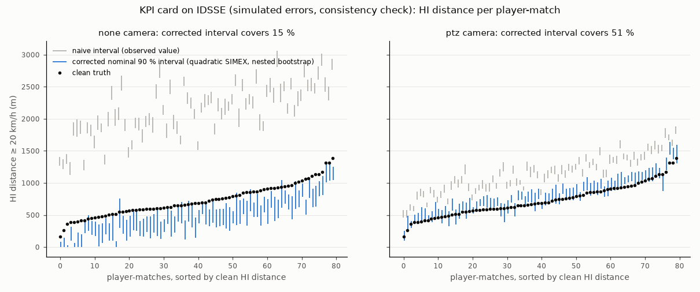

# KPI uncertainty card: a consistency check on IDSSE (T4.4)

> **Consistency check, not validation.** The "observed" tracks are clean IDSSE tracking plus errors
> simulated by the same model the card assumes (fitted on SN-GSR dev, `reports/kpi_budget_spectral.md`).
> Coverage here checks the card's arithmetic and its noise-on-noise approximation; it says nothing about
> whether the error model is right for real broadcast tracking.

- **Command**: `uv run python scripts/kpi_card.py --matches J03WMX J03WN1 J03WOH J03WOY --n-draws 20 --n-outer 8 --n-inner 8`
- **Git commit**: `1bb22eb`; date 2026-10-31T19:20:51; runtime 624.4 s
- **Error model** per camera: `matern32:copula:white` from `reports/error_process_temporal_dev.json` (`predfoot.kpi.noise.fit_error_model`).
- **Data**: IDSSE (Bassek, Rein, Weber & Memmert 2025, CC BY 4.0), 4 matches (J03WMX, J03WN1, J03WOH, J03WOY), 80 outfield player-matches with ≥ 45 min; 20 error draws per card, each at two doses; nested bootstrap with 8 pseudo-observations of 8 draws each; coverage intervals: 1000 bootstrap resamples over matches; seed 20261031.

## The card

From the observed track and the camera's error model only (`predfoot.kpi.card`): fresh errors are
drawn from the model and added to the observed track at one and two extra doses of error variance,
and the 10 fps KPI pipeline runs on each copy (SIMEX, Cook & Stefanski 1994). The **linear**
estimate removes the change caused by one extra dose (noise on noise); the **quadratic** one
extrapolates the parabola through zero, one and two extra doses back to no error. Estimates and
intervals that leave the KPI's support (all these KPIs are ≥ 0) are projected onto it. The
interval is estimate ± t·s: s² is the sampling variance of the estimate over the observed error,
from a nested parametric bootstrap (the same extrapolation on pseudo-observations, the observed
track plus one more model draw), plus the Monte Carlo variance of the draws, combined draw by draw
since both doses reuse each draw. The spread of one dose's effect, the previous choice of s,
understates the sampling variance of KPIs that jump with the track: the extrapolation amplifies
their noise. The intervals are model-based and uncalibrated, hence *nominal* 90 %. The **naive**
interval is the observed value ± t·(spread of one dose), without bias correction. The truth is the
clean track through the same 10 fps pipeline.

## Coverage of the clean truth

Coverage of nominal 90 % intervals across player-matches [95 % CI over matches]: quadratic and
linear with the nested-bootstrap variance, quadratic with the spread of one dose (previous
half-width), and naive. LOMO: the quadratic interval with a leave-one-match-out calibrated
half-width (median scale factor in brackets). Truncated: share of quadratic estimates projected
onto the support. Bias: relative error of the KPI summed over player-matches, before (observed)
and after correction (estimate). The observed bias comes from errors simulated by the model of
`reports/kpi_budget_spectral.md`, whose 5 fps check against SN-GSR fails (section 2 there): it
overstates the KPI bias of predfoot's real tracking and is not predfoot's KPI error.

| Camera | KPI | Quadratic | Quadratic, one-dose spread | Linear | Naive | Quadratic, LOMO-calibrated | Median half-width (rel.) | Truncated | Bias, observed | Bias after linear | Bias after quadratic |
|---|---|---|---|---|---|---|---|---|---|---|---|
| none | Distance | 0 % [0, 5]† | 0 % [0, 5]† | 0 % [0, 5]† | 0 % [0, 5]† | 89 % (×6.16) | 122 m (1 %) | 0 % | +41.6 % | +11.1 % | +4.9 % |
| none | HI distance (≥ 20 km/h) | 15 % [10, 22] | 5 % [1, 9] | 0 % [0, 5]† | 0 % [0, 5]† | 88 % (×2.62) | 144 m (22 %) | 6 % | +193.3 % | -76.8 % | -33.6 % |
| none | Sprint distance (> 25 km/h) | 57 % [40, 66] | 44 % [26, 56] | 1 % [0, 4] | 0 % [0, 5]† | 86 % (×1.99) | 108 m (77 %) | 4 % | +359.3 % | -97.2 % | +49.4 % |
| none | HSR efforts | 92 % [88, 98] | 54 % [44, 65] | 71 % [67, 75] | 60 % [53, 67] | 91 % (×0.98) | 14.3 (39 %) | 0 % | -14.1 % | -18.6 % | -11.7 % |
| none | Sprint efforts | 88 % [85, 90] | 52 % [48, 56] | 82 % [76, 90] | 62 % [54, 70] | 91 % (×1.19) | 7.3 (98 %) | 6 % | -26.0 % | -30.1 % | -22.5 % |
| none | PSV-99 | 72 % [68, 78] | 44 % [35, 51] | 65 % [54, 75] | 0 % [0, 5]† | 92 % (×1.58) | 3.2 km/h (11 %) | 0 % | +21.4 % | +7.1 % | +7.4 % |
| ptz | Distance | 39 % [19, 70] | 26 % [7, 59] | 0 % [0, 5]† | 0 % [0, 5]† | 85 % (×2.98) | 83 m (1 %) | 0 % | +18.5 % | +3.7 % | +1.2 % |
| ptz | HI distance (≥ 20 km/h) | 51 % [28, 64] | 38 % [21, 50] | 36 % [25, 46] | 0 % [0, 5]† | 89 % (×2.03) | 90 m (12 %) | 0 % | +57.0 % | -14.1 % | +9.8 % |
| ptz | Sprint distance (> 25 km/h) | 32 % [19, 44] | 15 % [8, 22] | 52 % [39, 69] | 0 % [0, 5]† | 91 % (×2.26) | 65 m (42 %) | 0 % | +95.3 % | -28.8 % | +46.4 % |
| ptz | HSR efforts | 91 % [87, 95] | 57 % [51, 63] | 86 % [82, 90] | 92 % [83, 99] | 90 % (×0.98) | 14.6 (40 %) | 0 % | -2.6 % | -9.3 % | -7.8 % |
| ptz | Sprint efforts | 90 % [83, 95] | 57 % [44, 71] | 88 % [75, 95] | 84 % [72, 95] | 88 % (×1.15) | 5.8 (81 %) | 5 % | -10.0 % | -15.9 % | -12.8 % |
| ptz | PSV-99 | 90 % [79, 98] | 69 % [56, 80] | 90 % [82, 98] | 2 % [0, 5] | 90 % (×1.04) | 2.1 km/h (7 %) | 0 % | +9.9 % | +2.1 % | +2.6 % |

† The bootstrap over matches collapsed to a point (every interval covers, or none does):
Clopper-Pearson interval over player-matches instead, which ignores the clustering by match.

## Example cards

**J03WOY, home #5**

| KPI | Card, none camera (nominal 90 %) | Card, ptz camera (nominal 90 %) | Clean truth |
|---|---|---|---|
| Distance | 10446 ± 144 m (observed 14454) | 10043 ± 123 m (observed 11950) | 9947 m |
| HI distance (≥ 20 km/h) | 259 ± 164 m (observed 1904) | 654 ± 115 m (observed 931) | 558 m |
| Sprint distance (> 25 km/h) | 212 ± 128 m (observed 655) | 271 ± 56 m (observed 282) | 157 m |
| HSR efforts | 22.9 ± 19.4 (observed 25.0) | 23.9 ± 19.0 (observed 27.0) | 29.0 |
| Sprint efforts | 5.6 [0.0, 12.6] (observed 5.0) | 9.9 ± 6.1 (observed 8.0) | 9.0 |
| PSV-99 | 29.5 ± 3.2 km/h (observed 33.6) | 31.8 ± 1.7 km/h (observed 33.2) | 30.3 km/h |

**J03WOH, home #34**

| KPI | Card, none camera (nominal 90 %) | Card, ptz camera (nominal 90 %) | Clean truth |
|---|---|---|---|
| Distance | 10520 ± 153 m (observed 14345) | 10282 ± 97 m (observed 12068) | 10100 m |
| HI distance (≥ 20 km/h) | 304 ± 159 m (observed 2078) | 829 ± 84 m (observed 1124) | 685 m |
| Sprint distance (> 25 km/h) | 274 ± 95 m (observed 777) | 284 ± 108 m (observed 348) | 149 m |
| HSR efforts | 38.5 ± 14.2 (observed 34.0) | 31.9 ± 17.7 (observed 37.0) | 37.0 |
| Sprint efforts | 11.3 ± 8.3 (observed 8.0) | 6.8 ± 5.1 (observed 7.0) | 10.0 |
| PSV-99 | 29.2 ± 2.5 km/h (observed 34.2) | 27.3 ± 1.3 km/h (observed 30.2) | 27.7 km/h |

**J03WMX, away #7**

| KPI | Card, none camera (nominal 90 %) | Card, ptz camera (nominal 90 %) | Clean truth |
|---|---|---|---|
| Distance | 12135 ± 158 m (observed 16052) | 11717 ± 111 m (observed 13533) | 11675 m |
| HI distance (≥ 20 km/h) | 623 ± 119 m (observed 2744) | 1123 ± 107 m (observed 1554) | 1066 m |
| Sprint distance (> 25 km/h) | 285 ± 196 m (observed 1055) | 264 ± 69 m (observed 426) | 163 m |
| HSR efforts | 50.8 ± 16.6 (observed 47.0) | 62.9 ± 22.9 (observed 56.0) | 58.0 |
| Sprint efforts | 5.3 ± 4.7 (observed 6.0) | 13.7 ± 7.8 (observed 11.0) | 11.0 |
| PSV-99 | 30.2 ± 1.9 km/h (observed 33.9) | 28.2 ± 1.5 km/h (observed 30.6) | 27.2 km/h |

## Reading it

- A naive interval around the observed value inherits the whole error-induced bias, which for
  distance KPIs is many half-widths (column *Naive*): the bias correction is the core of the card.
- The extrapolation assumes a smooth response of each KPI to the error variance. The linear step
  cannot follow a curved response (distance of slow phases grows like σ, threshold KPIs respond
  convexly); the quadratic one follows curvature, at the price of a larger sampling variance: it
  multiplies the observed value by 3, and for KPIs that jump with the track the averaged doses do
  not cancel that noise. Compare the columns *Quadratic* and *Quadratic, one-dose spread*.
- Where coverage stays below 90 % with the nested-bootstrap variance, the remaining extrapolation
  bias is the cause (compare *Bias after quadratic* with the half-width). The leave-one-match-out
  factor shows how much the half-width must grow to reach 90 %; it is fitted on the other matches
  only, on simulated errors, so it does not carry over to real tracking as such.
- Everything is conditional on the error model: on real tracking the card is only as good as the
  error process measured on SN-GSR (stationary, independent of motion, 5 fps, smoothed-label
  reference; see `reports/kpi_budget_spectral.md`).
